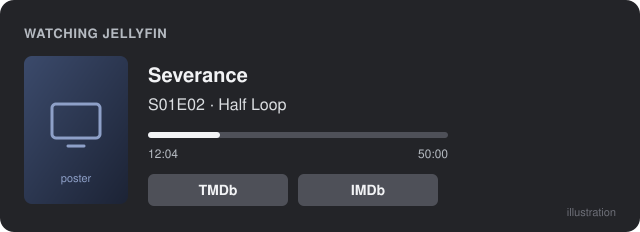

# PlayPresence

[](https://github.com/Dystilest/PlayPresence/releases)
[](https://github.com/Dystilest/PlayPresence/actions/workflows/ci.yml)
[](LICENSE)

**Show what you're watching on your Discord profile, straight from your own media server.**

<p align="center"></p>

When you play a movie or an episode on your Jellyfin server, your Discord status shows it, with the poster, the episode, a progress bar and links to TMDb and IMDb. When you pause, it says so. When you stop, it disappears.

New to all this? A **media server** like [Jellyfin](https://jellyfin.org) is a program that streams your own movies and shows to your TV, phone or browser. **Discord** can show what you're doing (a game, music, and with PlayPresence what you watch) on your profile, for your friends to see.

It's free and open source, needs no account and no API key, sends nothing to anyone but your own Discord app, and never changes anything on your server.

> **Status: early version (pre-1.0).** Jellyfin works today; Plex and Emby are next. See the [roadmap](docs/roadmap.md).

## Supported servers

| Server | Status |
|---|---|
| [Jellyfin](docs/jellyfin.md) | ✅ Supported |
| Plex | 🔜 Planned |
| Emby | 🔜 Planned |
| Kodi and others | Later, after 1.0 |

## Get started in 3 steps

**Before you begin:** you need the **Discord desktop app** (not the browser version) on the computer where you'll run PlayPresence, with **User Settings > Activity Privacy > Share my activity** turned on.

1. **Download** the file for your computer from the [latest release](https://github.com/Dystilest/PlayPresence/releases):
   - Windows: `playpresence_..._windows_amd64.zip`
   - Mac with Apple chip (M1 or newer): `playpresence_..._darwin_arm64.tar.gz`; older Intel Mac: `..._darwin_amd64.tar.gz`
   - Linux: `playpresence_..._linux_amd64.tar.gz`

   Unzip it anywhere you like (your Documents folder is fine). There is nothing to install.

2. **Set it up.**
   - **Windows:** double-click `playpresence.exe`. If Windows shows "Windows protected your PC", click **More info**, then **Run anyway** ([why?](docs/faq.md#windows-says-windows-protected-your-pc)).
   - **Mac and Linux:** open a terminal in that folder and type `./playpresence setup`.

   It asks for your Jellyfin server's address (the one you open in your browser; [can't find it?](docs/jellyfin.md#find-your-server-address)) and gives you a short code. Enter the code in Jellyfin (profile menu > **Quick Connect**). It never asks for your password.

3. **Play something.** On Windows, PlayPresence is already running: keep its window open (you can minimize it). On Mac and Linux, type `./playpresence run`. Start a movie or an episode in Jellyfin and look at your Discord profile.

To stop, close the window (or press Ctrl+C). Your Discord status is cleared.

Want to see it before connecting a server? Run `playpresence run --demo` to show a sample episode on your profile.

**Something not working?** Run `playpresence doctor`. It checks everything and tells you what to fix. Then see the [FAQ](docs/faq.md), or [ask for help](https://github.com/Dystilest/PlayPresence/discussions).

## Privacy, in short

- Your sign-in is kept in your computer's secure credential store (Windows Credential Manager, macOS Keychain, Linux Secret Service), never in a plain file or in logs.
- No telemetry, no analytics, no accounts, no update checks.
- Your server's address is never sent to Discord.
- What you watch is visible on your Discord profile to whoever can see your activity, like any game status. Stop PlayPresence, or change Discord's activity privacy setting, to hide it.

Details: [Privacy](docs/privacy.md). Found a security problem? Please read [SECURITY.md](SECURITY.md).

## How it works

PlayPresence connects to your media server (read-only), turns what is playing into a Discord status and hands it to the Discord app running on the same computer. If Discord restarts, the status comes back on its own.

```
media server --> PlayPresence --> Discord app on your computer --> your profile
```

Technical details: [Architecture](docs/architecture.md).

## Documentation

All guides are listed in the [documentation index](docs/README.md). The most useful ones:

- [Installation](docs/installation.md): every way to install, starting automatically, Docker
- [Jellyfin guide](docs/jellyfin.md)
- [FAQ and troubleshooting](docs/faq.md)
- [Configuration reference](docs/configuration.md)
- [Privacy](docs/privacy.md)
- [What is shown on Discord](docs/templates.md)
- [Roadmap](docs/roadmap.md)
- [Architecture](docs/architecture.md) and [adding a media server](docs/adding-a-source.md), for developers

## Get involved

Everyone is welcome, and you don't need to write code to help:

- **Tell us what doesn't work:** [report a bug](https://github.com/Dystilest/PlayPresence/issues/new/choose).
- **Ask a question or share an idea:** [Discussions](https://github.com/Dystilest/PlayPresence/discussions).
- **Improve the docs:** if a step confused you, a fix helps the next person.
- **Write code:** start with [CONTRIBUTING.md](CONTRIBUTING.md) and issues labelled [good first issue](https://github.com/Dystilest/PlayPresence/labels/good%20first%20issue).

Please follow the [Code of Conduct](CODE_OF_CONDUCT.md).

## License

[MIT](LICENSE): free to use, change and share.
